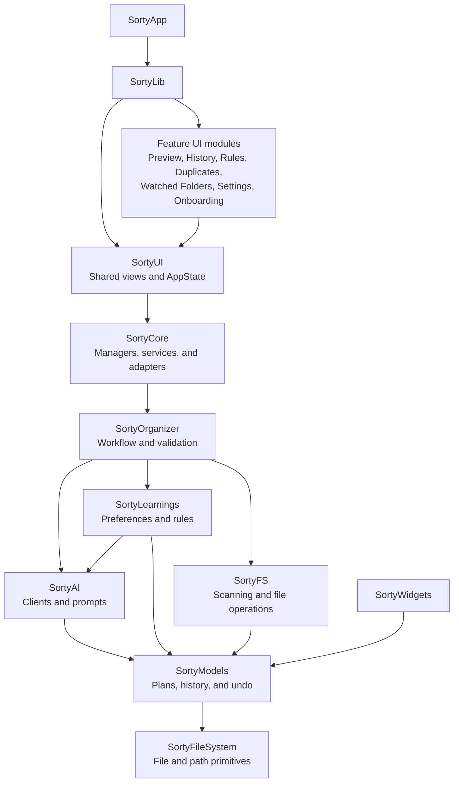

<h1 align="center">Sorty  - Smart Folder Organizer for macOS</h1>


[](https://www.gnu.org/licenses/gpl-3.0)
[](https://swift.org)
[](https://www.apple.com/macos)
[](https://github.com/sorty-organizer/Sorty/actions/workflows/swift.yml)

A native macOS SwiftUI app that uses AI to organize files into relevant, semantically named folders.

[Visit the Sorty website](https://sorty-organizer.github.io/Sorty/) for the product overview, privacy details, comparisons, and latest release.

|  |  |  |
| :---: | :---: | :---: |
| *Organize your workspace* | *Preview every move before applying it* | *Review duplicate files clearly* |


## Features

- **Intelligent Organization**: Sorty understands file content and context for accurate categorization.
- **The Learnings Profile**: A passive learning system that trains from your existing folder structures, manual corrections, and even cancelled organizations to continuously improve future suggestions.
- **Custom Personas**: Create and edit specialized profiles for different workflows (e.g., Developer, Photographer, Student).
- **Multiple AI Providers**: 
  - OpenAI, OpenCode Zen and Go, Anthropic, Gemini, Groq, OpenRouter, Ollama, and custom OpenAI-compatible endpoints.
  - Apple Foundation Models (on-device and privacy-focused; requires macOS 26+ with Apple Intelligence).
- **Vision Support**: Multimodal analysis for providers that support it to understand image content when organizing.
- **Finder Extension**: Right-click any folder in Finder to instantly start the organization process.
- **App-Wide Deeplinks**: Control the app externally via `sorty://` URL schemes for automation and shortcuts.
- **Menu Bar Controls**: Quick access with keyboard shortcuts for common actions.
- **Interactive Preview**: Review and tweak suggested organization before any files are moved.
- **Organization History**: Track all operations with detailed analytics, reasoning, and rollback support.
- **Automatic Updates**: Background update checking on app launch (once per 24 hours) with manual check available via menu.
- **Storage Locations**: Define custom storage destinations for organized files.
- **HUD Notifications**: Non-intrusive visual feedback and actions for operations and status updates.
- **Safe by Design**: Includes dry-run modes, comprehensive validation, duplicate protection settings, and exclusion rules.


## Quick Start

### Use Sorty from your agent

Install the Sorty skill from onboarding or Settings > Features > Sorty Skill.
Choose Codex, Claude Code, OpenCode, Pi, or a custom agent folder, then select
which preferences and Learnings to import. Ask your agent to organize, rename,
find exact duplicates, or restore recorded moves. These workflows run without
the app; Finder integration and background watching still need the native app.
See the [Sorty skill guide](docs/sorty-skill.md) for setup and safety rules.

### Prerequisites
- macOS 15.0 or later
- Xcode 16.0 or later
- (Optional) API key for OpenAI or compatible provider

### Installation

#### Option 1: Download Pre-Built Release (Easiest)

1. Download the latest `.zip` from the [Releases](https://github.com/sorty-organizer/Sorty/releases) page.
2. Unzip and drag `Sorty.app` to your `/Applications` folder.
   > **Note**: Moving the app to `/Applications` is highly recommended. It ensures that security bookmarks for "Watched Folders" persist reliably across app restarts.
3. **Important**: Since the app is not notarized (no Apple Developer certificate), you need to remove the quarantine attribute:
   ```bash
   sudo xattr -cr /Applications/Sorty.app
   ```
   Paste the command into Terminal, press Return, and enter your Mac password. Terminal does not show the password while you type it.
4. Open Sorty from `/Applications`.

> [!NOTE]
> The command changes extended attributes only on the `Sorty.app` copy in `/Applications`, clearing the quarantine metadata that can block an unsigned app. Use it only for a copy downloaded from this repository.

#### Option 2: Build from Source

**Using Make (Recommended):**
```bash
git clone https://github.com/sorty-organizer/Sorty.git
cd Sorty
make run
```

**Using Xcode:**
1. Open `Sorty.xcodeproj` in Xcode.
2. Select the `Sorty` scheme and your Mac as the destination.
3. Press `⌘R` to build and run.

## Configuration

### 1. AI Provider Setup
- Navigate to the **Settings** tab in the app.
- Configure your preferred provider:
  - **OpenAI-Compatible**: Enter the API URL and your private key.
  - **Apple Foundation Models**: Requires macOS 26+ with Apple Intelligence enabled.

### 2. Finder Integration
Sorty includes Finder Integration as a core app feature:
1. Open **Settings -> Finder Integration**.
2. Use **Activate** or **Repair** if the Finder extension needs attention.
3. Use **Open Extensions** and confirm **SortyFinderSync** is enabled in macOS Extensions settings.

> [!IMPORTANT]
> The Finder extension requires **App Groups** to be configured in both the main app and extension targets using the identifier `group.com.sorty.app`.

### 3. Watched Folders
- Add folders to the "Watched" list in the sidebar to enable automatic background monitoring.
- **Note**: The "Auto-Organize" feature will remain disabled until a valid provider is configured in Settings.


## Security Considerations

Sorty is designed with security and privacy in mind:

**Data Handling:**
- File analysis happens via your chosen provider, including supported cloud services, Ollama, or Apple Foundation Models
- Sorty sends relative folder structure and available file metadata to your selected provider; Deep Scan additionally extracts supported content locally and sends bounded text and metadata summaries
- API keys are stored in the macOS Keychain
- The Learnings profile is encrypted with AES-256 and stored locally. Sensitive Action Authentication optionally protects actions with Touch ID or your Mac login password and is off by default. Learning analysis and organization send relevant learning context to the selected AI provider.
- **Privacy Mode**: Enabled by default, blurs sensitive handles until hover and hides API keys with a manual reveal toggle.

**Release Signing:**
Pre-built releases are NOT code-signed. You will need to remove macOS quarantine flags after installation (see Installation section). Build from source if you prefer complete control.

**Best Practices:**
- Use Ollama or Apple Foundation Models for on-device processing. For very large directories, choose a model with enough context capacity.
- Review which files are being sent to cloud AI providers
- Enable Safe Deletion for duplicate management
- Regularly backup important directories

For detailed security information, see [SECURITY.md](SECURITY.md).

## Troubleshooting

### "Watched Folders" Access Lost
If you see an error indicating that access to a watched folder has been lost (e.g., "Permission Denied" or missing bookmarks):
1. This is often due to macOS App Sandbox restrictions.
2. Ensure the app is running from the `/Applications` folder.
3. Remove the folder from the Watched list and add it again to refresh the security bookmark.

### Provider Not Configured / Auto-Organize Disabled
- If "Auto-Organize" is grayed out or not functioning, check **Settings -> AI Provider**.
- A valid API configuration (or Apple Intelligence setup) is required for the app to analyze and sort files.

### Update Check Issues
- If update checks fail, verify you have an active internet connection.
- Check if you can access [GitHub Releases](https://github.com/sorty-organizer/Sorty/releases) in your browser.
- Rate limiting may occur if too many requests are made; wait a few minutes and try again.


### Verifying App is Up to Date
1. Open **Settings** and click **Check for Updates**.
2. If the app shows "Up to date", you have the latest version.
3. Alternatively, compare the version in **About** with the [latest release](https://github.com/sorty-organizer/Sorty/releases/latest).

New installations use the version-independent [`Sorty.zip`](https://github.com/sorty-organizer/Sorty/releases/latest/download/Sorty.zip) download. Move `Sorty.app` to `/Applications`; Sorty opens onboarding until setup is completed.

## Project Structure

| Location | Responsibility |
|----------|----------------|
| `Sources/SortyApp/` | SwiftUI lifecycle, windows, and background coordination |
| `Sources/SortyLib/` | App shell, organize flow, navigation, commands, and resources; re-exports the UI modules |
| `Sources/SortyUI/` | Shared SwiftUI components, `AppState`, and auxiliary windows |
| `Sources/Sorty*UI/` | Feature views in `SortyPreviewUI`, `SortyHistoryUI`, `SortyRulesUI`, `SortyDuplicatesUI`, `SortyWatchedFoldersUI`, `SortySettingsUI`, and `SortyOnboardingUI` |
| `Sources/SortyCore/` | Shared managers, view models, app services, and adapters for lower modules |
| `Sources/SortyOrganizer/` | `FolderOrganizer`, plan validation, and organization workflow |
| `Sources/SortyAI/` | Provider clients, prompts, model catalog, and response parsing |
| `Sources/SortyLearnings/` | Preference learning, profile storage, observation, and local rule inference |
| `Sources/SortyFS/` | Directory scanning, content and vision analysis, file operations, duplicates, and watching |
| `Sources/SortyModels/` | Data models, history, undo operations, and widget snapshots |
| `Sources/SortyFileSystem/` | File naming, hashing, and path primitives |
| `Sources/SortyFinderSync/`, `Sources/SortyWidgets/` | Finder Sync and WidgetKit extensions |
| `Sources/SortyQuality/`, `Sources/SortyQualitySupport/` | Organization quality CLI and support library |
| `Tests/SortyTests/`, `Tests/SortyUITests/` | Unit, integration, UI, and accessibility tests |
| `website/`, `scripts/` | Public Next.js website and build/automation scripts |

## Architecture

Sorty uses SwiftUI with MVVM and services. `SortyApp` creates shared managers and injects them into the view hierarchy. `SortyLib` composes the app shell from shared and feature UI modules. Feature modules compile separately so editing one view does not rebuild every SwiftUI module.

### Module dependencies

Arrows point from a module to its dependencies. The diagram shows the main layers; `Package.swift` lists all direct dependencies.



Each feature UI module depends on `SortyUI`. `SortyHistoryUI` also depends on `SortyPreviewUI`, and `SortyWatchedFoldersUI` depends on `SortyHistoryUI`. Shared views belong in `SortyUI`; cross-module implementation uses `package` access.

`SortyCore` connects lower modules to app services through injected hooks and adapters for Keychain, logging, analytics, notifications, and Finder integration. `SortyModels` depends only on `SortyFileSystem`; provider clients and network details stay in `SortyAI`.

### Organization flow

Finder actions, `sorty://` deeplinks, App Intents, menu bar actions, and watched-folder automation feed the app's organization workflow.


`FolderOrganizer` owns the state sequence `idle → scanning → organizing → ready → applying → completed`, including cancellation and error handling. AI clients implement `AIClientProtocol` and register with `AIClientFactory`.

Persistence uses files, `UserDefaults`/`@AppStorage`, security-scoped bookmarks, and Keychain. Finder and widget integration share data through the app group `group.com.sorty.app`; widgets read snapshots defined in `SortyModels`.

See the [architecture guide](docs/agent-guides/architecture.md) for implementation patterns and [startup performance guide](docs/agent-guides/startup-performance.md) for deferred loading rules.

## Contributing

We welcome contributions. See [CONTRIBUTING.md](CONTRIBUTING.md) for:
- Detailed development environment setup
- Architecture overview and code style guidelines
- How to add new AI providers
- Testing requirements and PR process

Please read our [Code of Conduct](CODE_OF_CONDUCT.md) before participating.

## Testing

Blacksmith-backed GitHub Actions are the source of truth for commit, push, PR, and release confidence. The default Swift CI workflow runs security checks on Blacksmith Ubuntu and builds/tests/packages on Blacksmith macOS.

Prefer frequent small commits and pushes. Push each coherent change to the branch so Blacksmith validates the real PR state early; continue with follow-up commits when more work remains.

### Local Diagnostics

Use local commands only for fast diagnosis before pushing:
```bash
make dev                                      # Fast debug build, no tests
make now                                      # Fast debug build + launch, no tests
make daily                                    # Optimized local build + launch, no tests
swift test --disable-sandbox --filter SortyTests.TestClass/testMethod
```

`make ci`, `make test`, and `make test-full` still exist for local troubleshooting, but they do not replace Blacksmith checks.

Run the reproducible filename, path, rename-rule, and AI response fuzzer with
`bash scripts/fuzz.sh --seed 357813081177 --iterations 20000`.
It compiles the production leaf sources without fetching app dependencies or
launching Sorty. See [Fuzzing](docs/agent-guides/fuzzing.md) for coverage and replay.

Use `make daily` for everyday use or startup profiling. `make now` prioritizes
compile speed and leaves an unoptimized Debug app; `make hot` also embeds the
InjectionLite runtime. All three replace `releases/Sorty.app`, so run `make daily`
again after development to restore the optimized app.

### Blacksmith Validation

For PRs and releases, rely on the GitHub Actions checks:
- **Swift CI**: security scan, SPM build, current test inventory, parallel unit tests, app bundle build.
- **Release**: changelog preparation, current test inventory, parallel unit tests, universal app build, Sparkle appcast generation, release artifact upload.

### Test Coverage

Tests are located in `Tests/SortyTests/` and cover the following areas:

- **Unit Tests**: Core functionality including file organization, duplicate detection, exclusion rules, response parsing, and utility functions.
- **Integration Tests**: End-to-end workflows for AI providers, file system operations, and history management.
- **Component Tests**: Individual modules such as personas, learnings manager, deeplinks, and security.

Key test files include:
- `SortyTests.swift` - Core organization logic
- `LearningsManagerTests.swift` - Passive learning system
- `FinderIntegrationStatusTests.swift` - Finder Sync diagnostics, registration parsing, and auto-repair
- `StorageDestinationNormalizerTests.swift` - Storage location path resolution and normalization
- `StorageLocationsReliabilityTests.swift` - Storage validation and reliability
- `PrivacyPathMaskerTests.swift` - Privacy-sensitive path redaction
- `CustomPersonaTests.swift` - Persona management
- `DeeplinkTests.swift` - URL scheme handling

## Deeplinks Reference

Sorty supports the `sorty://` URL scheme for automation and external control:

| Deeplink | Description |
|----------|-------------|
| `sorty://organize?path=<path>&persona=<id>&autostart=true` | Start organization |
| `sorty://duplicates?path=<path>&autostart=true` | Scan for duplicates |
| `sorty://learnings?action=stats` | Open Learnings statistics |
| `sorty://settings?section=ai` | Open specific settings section |
| `sorty://history` | Open organization history |
| `sorty://history?entry=<uuid>` | Open a specific history session |
| `sorty://persona?generate=true&prompt=<text>` | Generate a persona |
| `sorty://watched?action=add&path=<path>` | Add watched folder |
| `sorty://rules?action=add&pattern=<pattern>` | Add exclusion rule |
| `sorty://help?section=<topic>` | Open help section |

## License

This project is licensed under the GNU General Public License v3.0 - see the [LICENSE](LICENSE) file for details.

## Support

- **Documentation**: See [HELP.md](https://github.com/sorty-organizer/Sorty/blob/main/HELP.md) for detailed usage guides
- **Bug Reports**: Use the [Bug Report template](../../issues/new?template=bug_report.md)
- **Feature Requests**: Use the [Feature Request template](../../issues/new?template=feature_request.md)
- **Security Issues**: Use [GitHub private vulnerability reporting](https://github.com/sorty-organizer/Sorty/security/advisories/new) (do not open public issues)
- **Questions**: Open a [GitHub Discussion](../../discussions)

#

<div align="center">
  
  <br>
  <strong>Sorty: The FOSS File Organiser</strong>
</div>
